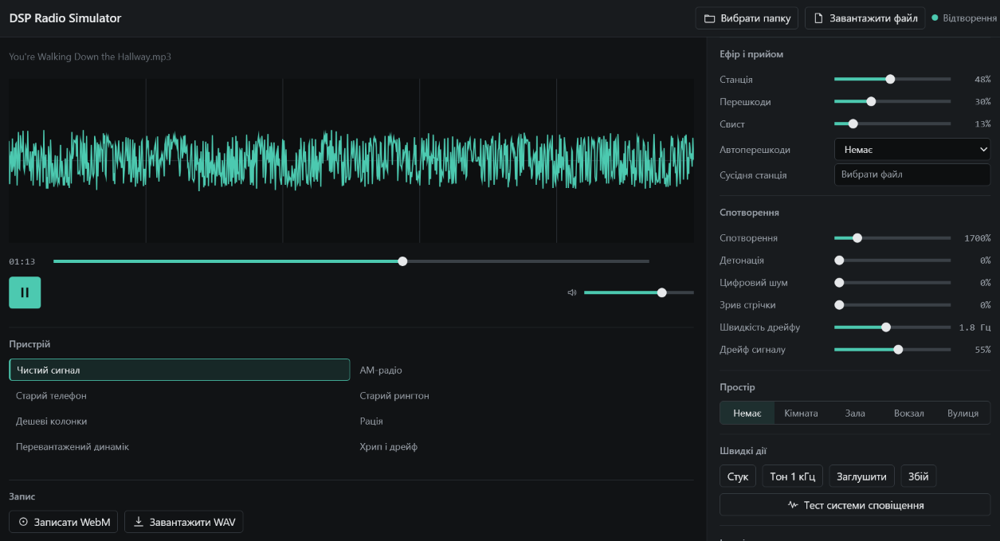

# DSP Radio Simulator

**DSP Radio Simulator** is a browser-based DSP tool for modelling radio reception and playback. It processes local audio files in real time to reproduce the spectral, dynamic, and stability changes associated with analogue signal paths and low-cost playback hardware.

The project is not affiliated with an existing radio station.

## Interface



## Purpose

The application is intended for sound design, post-processing, Web Audio API experimentation, and the creation of atmospheric effects: AM radio, telephone lines, walkie-talkies, overloaded speakers, distant public-address systems, and unstable shortwave reception.

It is not an electromagnetic propagation simulator. It does not calculate antenna patterns, terrain losses, or ionospheric propagation. Instead, it models the **audible effects** of channel and receiver limitations: bandwidth loss, noise, parasitic modulation, adjacent-channel interference, gain variation, and non-linearity.

## Signal Model

Processing is implemented as a Web Audio API node graph. Parameters are smoothed over time to avoid abrupt digital clicks when a mode or control changes.

### Bandwidth and tuning

The programme signal passes through high-pass and low-pass filters that define the available channel bandwidth:

- narrow bandwidth removes bass and high frequencies, as in telephone and AM paths;
- an additional low-pass filter narrows the signal as virtual tuning moves away from centre;
- cutoff frequency and noise level both depend on virtual detuning, so the signal loses high-frequency detail while becoming less intelligible.

### Adjacent station and noise

A second audio file can be loaded as an interfering station. It loops independently and is mixed with the programme through a dedicated gain node. Its level follows a smooth tuning curve rather than a binary source switch.

White noise is generated from a prebuilt buffer and added to the signal path. Automatic interference periodically varies the adjacent-station offset and noise contribution to create irregular reception drift.

### Non-linearity and digital artefacts

After source mixing, the signal passes through these stages:

- a `WaveShaperNode` with a non-linear transfer curve, modelling amplifier and loudspeaker overload;
- amplitude quantisation, modelling limited bit depth and coarse digital paths;
- a `DynamicsCompressorNode`, modelling the dense dynamics of low-cost transmitters and playback devices.

The order of processing matters: filtering before and after non-linearity produces different harmonic spectra. The application therefore uses a fixed sequence of filtering, non-linearity, quantisation, and compression.

### Carrier instability and mechanical degradation

Wow and flutter are built with a short delay line whose delay time is modulated by a low-frequency oscillator. This changes instantaneous playback speed and produces audible pitch instability.

Atmospheric drift is implemented as low-frequency gain modulation: the signal periodically fades and returns, resembling slowly changing reception conditions. Tape snags add occasional random delay jumps on top of the continuous modulation.

### Spatial modes

Spatial modes do not rely on recorded room samples. They are assembled from filtering, delay, feedback, and a synthetic impulse response:

- **Room** — reduced high frequencies and a muffled path;
- **Hall** — convolution with a synthetic impulse response;
- **Station** — public-address filtering, delay, and feedback;
- **Street** — a more distant public-address path with reflections.

## Features

- Load a single MP3, WAV, or OGG file, or choose a folder of supported files.
- Random playback from the selected folder.
- Presets that define filtering, noise, overload, wow/flutter, and quantisation settings.
- Manual reception controls for an adjacent station, noise, heterodyne whistle, and automatic interference.
- Manual degradation controls for distortion, wow/flutter, digital noise, drift, and tape snags.
- Spatial modes and utility signals: tap, 1 kHz test tone, mute, signal crash, and alert-system test.
- Output waveform display via `AnalyserNode`.
- Real-time WebM recording and offline WAV rendering.

## Architecture

```text
Programme file ─┐
                ├─> tuning / mixing ─> wow & flutter ─> AM drift
Adjacent file ──┘                                      │
Noise and tones ───────────────────────────────────────┤
                                                        v
    HP/LP filters ─> non-linearity ─> quantisation ─> compressor
                                                        │
                                                        v
                                           spatial path / analyser
                                                        │
                                   speakers + MediaRecorder + export
```

Key modules:

- [`App.tsx`](./App.tsx) — UI state, file loading, and parameter controls.
- [`services/AudioEngine.ts`](./services/AudioEngine.ts) — Web Audio API graph, recording, and offline rendering.
- [`utils/audioUtils.ts`](./utils/audioUtils.ts) — distortion curves, noise buffer, impulse response, and WAV encoding.
- [`constants.ts`](./constants.ts) — immutable preset configurations.
- [`components/Visualizer.tsx`](./components/Visualizer.tsx) — waveform rendering with `devicePixelRatio` support.

## Technology

- React 19
- TypeScript
- Vite
- Web Audio API
- MediaRecorder API
- CSS custom properties for interface tokens and components

## Running locally

Node.js 18 or later is required.

```bash
git clone https://github.com/bermichevvolodymyr/dsp_radio_simulator.git
cd dsp_radio_simulator
npm install
npm run dev
```

To produce a production build:

```bash
npm run build
```

## Compatibility

- Folder selection requires the File System Access API, typically available in Chrome and Edge.
- Loading an individual file does not depend on that API.
- Recording requires `MediaRecorder` support and an available WebM codec.
- Source-file decoding and available formats depend on the browser.

## License

Distributed under the [MIT License](./LICENSE).
